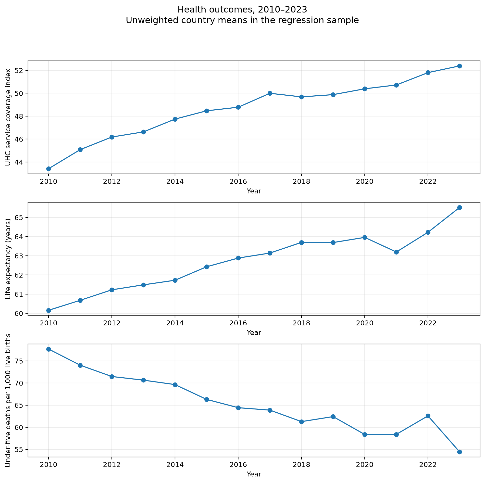
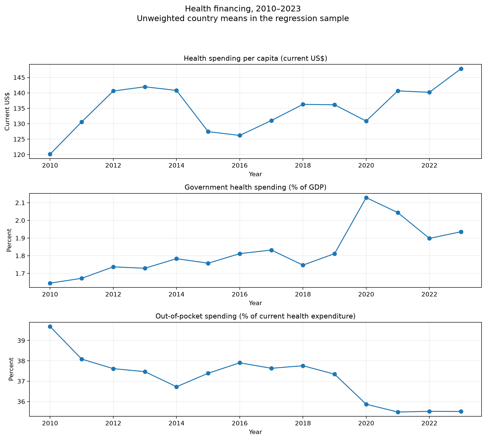

# Health financing and population health in Africa, 2010–2023

An exploratory panel capstone on health financing, UHC service coverage, life expectancy and under-five mortality.

**Reproducibility:** the organized notebook completed all 17 code cells in a fresh local kernel on 11 November 2026. Its model, sensitivity and annual-summary tables match the completed Colab run within 1e-8. All 84 checked outcome values in a new WDI extract also match the original workbook exactly.

## Findings
The nine models include country/year fixed effects, log GDP per capita and one financing measure at a time. All financing 95% confidence intervals include zero. This is insufficient evidence of an association under these specifications, not proof of no effect. The mortality spending coefficient changes from +7.3335 to −0.4913 in a historical five-record exclusion check, so its magnitude and direction are sensitive to those observations. Relationships are observational, not causal.

## Files
- `notebooks/africa_health_financing_executed.ipynb`: reviewed, freshly executed edition with outputs.
- `notebooks/africa_health_financing.ipynb`: same organized source without outputs, for rerunning.
- `notebooks/colab_run_as_received.ipynb`: original successful Colab run preserved unchanged.
- `results/tables/` and `results/figures/`: model tables, source/sample audits and generated charts.
- `reports/CAPSTONE_REPORT.md`: substantive findings and limitations.
- `reports/REVIEW.md`: checks performed and release status.
- `reports/SOURCE_VERIFICATION.md`: the completed 84-value WDI comparison.
- `reports/DATA_DICTIONARY.md`: definitions, indicator codes and units.
- `GITHUB_UPLOAD.md`: steps for placing this project on GitHub.

## Reproduce
From the repository root, create a fresh Python environment and install `requirements.txt`:
```sh
python -m venv .venv
# Windows: .venv\Scripts\activate
# macOS/Linux: source .venv/bin/activate
python -m pip install -r requirements.txt
jupyter lab
```
Open the organized notebook, restart its kernel and run all cells. Alternatively:
```sh
jupyter nbconvert --to notebook --execute notebooks/africa_health_financing.ipynb --ExecutePreprocessor.timeout=300 --output africa_health_financing_executed.ipynb
```
Python 3.12 on Windows was tested. `requirements-lock-windows.txt` records the exact installed package set used for validation, including Windows-specific notebook dependencies. Use the general requirements for Colab and other platforms; those platforms were not freshly retested during the final local check.

The exact workbook is included under `data/raw/` in the downloadable project package. For a clone without the workbook, put `Raw_WDI_Data_Africa.xlsx` there or set `AFRICA_WDI_PATH` to its path. If using Colab with only the notebook, its first cell prompts for the workbook. The workflow makes no live World Bank API request. The run manifest records the input SHA-256 and analysis package versions.

## Data and interpretation
The source worksheet is Data (2), covering 2010–2023. The descriptive panel has 742 country-years across 53 countries. The common regression sample contains 713 country-years across 52 countries. Annual counts are 51 except 2012 (50); membership changes across years. Exclusions: Eritrea 12 rows, Somalia 3, South Sudan 14. Djibouti is absent from the export, so this is not complete coverage of every African country. The original acquisition URL/date and country-selection rationale remain undocumented.

The export uses SH_UHC_SCI for UHC. Monetary variables are current US dollars. Government spending is a share of GDP, while out-of-pocket spending is a share of current health expenditure. Trends are unweighted country means, not population-weighted African estimates. No imputation or source-value correction was applied.

The unusual mortality and life-expectancy observations for CAF, Somalia and South Sudan match a newly supplied WDI extract for every study year (84/84). They are retained. Agreement with WDI is not independent validation of the underlying demographic estimates. The historical exclusion is an influence sensitivity, not a corrected dataset. See the report for interpretation and further limitations.

## Figures




## Data attribution and code license
The supplied export contains World Bank WDI metadata citing WHO for UHC, UN IGME for under-five mortality, and UN population/statistical sources for life expectancy. Definitions, source attribution and indicator licenses are retained in `results/tables/source_metadata.csv`; verification downloads are preserved in `data/verification/`. Record the original download URL and acquisition date when available. The raw workbook and verification XLSX files are ignored by Git by default, while the downloadable local package preserves them.

The project author has not yet selected a software license. No license grant for the project code is asserted here. Data-source terms and code licensing are separate. No GitHub repository has been created or uploaded by this review.
